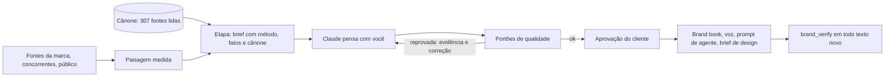

# Brand Genome

**Engenharia de marca com evidência: marcas específicas, próprias e prontas para o mercado — nunca genéricas.**

O Brand Genome é o irmão do [Design Genome](https://github.com/ThunderBR2/design-genome). O Design Genome faz engenharia reversa de sistemas visuais. O Brand Genome faz o mesmo com a estratégia e a linguagem de uma marca: posicionamento, plataforma, naming, tom de voz, ativos distintivos, narrativa e ativação. Ele tem três partes.

1. **Um cânone** destilado de 307 fontes de branding lidas de verdade (330 catalogadas; as 23 restantes estavam bloqueadas ou atrás de paywall e ficam só como referência): ciência de marketing (Ehrenberg-Bass), eficácia (IPA, Binet & Field, System1), posicionamento (Ries & Trout, Keller, Dunford, Ritson), identidade verbal (GOV.UK, Mailchimp, Monzo, NN/g), naming (Catchword, Igor, Labbrand), ativos distintivos (Romaniuk, Ipsos × JKR), o debate sobre propósito, mais de 150 cases e fracassos, e fontes brasileiras (Kantar BrandZ Brasil, Bedendo, Ana Couto, Troiano, Lei 15.263). Ao todo são 213 princípios (156 confirmados por duas ou mais fontes independentes, contando cada página e cada autor uma vez só), 86 frameworks, 29 debates entre escolas, 143 cases, 144 antipadrões e 885 termos que denunciam linguagem genérica, em português e inglês.
2. **A categoria medida.** O sistema lê os sites dos concorrentes e mostra o que quase todos repetem: o "mar de mesmice", com a frase de cada um como prova. Mostra também como cada marca soa, o que o público diz com as próprias palavras e onde está o espaço livre.
3. **Um processo em 11 etapas com portões de qualidade.** Cada entrega é verificada. Um diferencial que já aparece no site de um concorrente é barrado com a evidência. O mesmo acontece com um manifesto cheio de clichês, um posicionamento sem renúncia ou um propósito sem prova operacional.

No fim, qualquer texto da marca passa pelo **verificador**. A nota depende dos concorrentes carregados no projeto; o exemplo abaixo é do projeto de teste. Ele mede linguagem genérica, convenções da categoria, semelhança com concorrentes (o teste de troca), especificidade e fidelidade ao tom de voz. Cada desvio vem com o trecho e a correção.

```
Verificação: "Somos apaixonados por café e oferecemos uma experiência única…"
Nota 16/100 — genérico: reescreva
- [alta] O texto repete o que a categoria inteira diz: "experiência única" (100% dos concorrentes), "grãos selecionados" (100%)…
- [media] "somos apaixonados por" é clichê → conte o que vocês fazem que ninguém faria sem gostar muito
- [media] O vocabulário está muito próximo do de Café Aurora (similaridade 0.357)

Verificação: "Toda terça e quinta a Marina torra 12 kg de café de seis sítios da Mantiqueira…"
Nota 100/100 — forte: específico e com cara de marca
```

## Como funciona



### As 11 etapas

| # | Etapa | O que entrega | Exemplos de portões |
|---|---|---|---|
| 1 | Diagnóstico | negócio, ambição, problema de marca, verdades do negócio, ativos existentes | verdades verificáveis; em rebrand, ativos com equity mapeados |
| 2 | Paisagem | concorrentes, alternativas, convenções seguir/quebrar, espaços livres | cada convenção medida decidida; ao menos uma quebrada |
| 3 | Público | público, tensões, palavras do público, pontos de entrada da categoria, insights | palavras vindas das fontes do público; 5+ pontos de entrada |
| 4 | Posicionamento | quadro de referência, paridade, diferenciais com prova, "só nós", sacrifício, oposto plausível | diferencial não pode aparecer em concorrente; declaração não genérica; sacrifício obrigatório |
| 5 | Plataforma | ideia de marca, crenças, valores como comportamento, personalidade é/não é, promessa, pilares | propósito só com provas operacionais; valores com comportamento |
| 6 | Arquitetura (opcional) | modelo e regras | justificativa e regras aplicáveis |
| 7 | Naming (opcional) | critérios, candidatos, verificações | triagem automática; busca no INPI antes de "escolhido" |
| 8 | Voz | traços com faça/não faça, mapa de tom, léxico, gramática mensurável, antes/depois | exemplos precisam passar no verificador |
| 9 | Ativos | ativos distintivos, direção visual, som, movimento | ativos raros na categoria; equity mantida |
| 10 | Narrativa | manifesto, história, casa de mensagens, assinaturas, pitch | manifesto com nota 70+ |
| 11 | Ativação | lançamento, consistência, medição curta e longa, governança | medição de longo prazo obrigatória |

### Escolas que discordam

O cânone não mistura escolas em silêncio. Os 29 debates mostram onde elas divergem (diferenciação × distintividade, propósito, alcance × segmentação, evoluir × romper, voz × tom…) e qual é a posição padrão do sistema. Conflitos do projeto, como "o diferencial declarado já aparece no concorrente X" ou "a voz definida é diferente da voz medida no site atual", ficam abertos até você decidir.

## Começando

**Windows, um clique:** baixe [`scripts/instalar-brand-genome.bat`](scripts/instalar-brand-genome.bat) e o `.ps1` ao lado, na mesma pasta, e abra o `.bat`. Ele instala em `%USERPROFILE%\BrandGenome` e conecta ao Claude Desktop.


> **Passo a passo:** [docs/comecando.md](docs/comecando.md)

Requisito: Node.js 22+. O Chromium é opcional: sem ele os sites comuns são lidos normalmente; com ele, também os montados por JavaScript.

```bash
git clone https://github.com/ThunderBR2/brand-genome
cd brand-genome
npm install
npm run build
npm link                       # deixa o comando "brand" disponível
brand mcp-config --install     # conecta ao Claude Desktop (com backup da config)
```

Feche e abra o Claude Desktop. Depois é só pedir: "crie uma marca para uma torrefação de café em Bragança, os concorrentes são estes sites…".

Pelo terminal:

```bash
brand init "Grão Alto" --sector "cafe especial"   # --lang en para marcas em inglês
brand add https://concorrente1.com.br --role concorrente --entity "Concorrente 1"
brand add ./avaliacoes.csv --role publico
brand add ./briefing.docx --role cliente
brand landscape
brand stage posicionamento
brand verify "texto para checar"
brand export brandbook-html
```

## Ferramentas para a sua IA (MCP)

| Ferramenta | Para quê |
|---|---|
| `brand_projects`, `brand_status` | projetos e próximo passo |
| `brand_add_sources`, `brand_add_note`, `brand_sources`, `brand_remove_source`, `brand_reextract` | fontes com papel: cliente, concorrente, público, categoria, referência, pesquisa |
| `brand_landscape` | convenções da categoria, voz de cada marca, palavras do público, espaço livre |
| `brand_stage_request`, `brand_stage_submit`, `brand_stage_approve` | o processo em 11 etapas, com portões |
| `brand_conflicts`, `brand_resolve_conflict` | conflitos e decisões do usuário |
| `brand_verify` | nota e desvios de qualquer texto, arquivo ou URL |
| `brand_name_check` | triagem de nomes e verificações manuais (INPI, WIPO, domínio, nativos) |
| `brand_brief` | o genoma da marca em um brief compacto |
| `brand_canon_search`, `brand_canon_card`, `brand_canon_stats` | consultar o cânone |
| `brand_canon_dissect_request`, `brand_canon_dissect_submit` | crescer o cânone com novas fontes |
| `brand_export` | brand book (MD e HTML), brief, voz em JSON, prompt de agente, brief de design, paisagem, JSON |
| `brand_update` | atualizar a partir do GitHub (só quando você pedir; compila à parte e volta à versão anterior se algo falhar) |

Junto vem a skill [`skills/brand-genome/SKILL.md`](skills/brand-genome/SKILL.md).

## Integração com o Design Genome

A etapa de ativos gera o `design-brief`, com a ideia de marca, a tradução da personalidade em decisões visuais, os ativos a construir e as convenções visuais a evitar. No Design Genome você aprende as referências, planeja as peças com `genome_blueprint` e confere cada uma com `genome_verify`.

## Uso responsável

- O cânone é **conhecimento destilado**: princípios parafraseados com a fonte citada, nunca texto copiado. Há no máximo uma citação curta por fonte. Fontes bloqueadas a robôs (WARC, Cannes Lions, Effie, Fonts In Use) não foram coletadas. Nada foi tirado de cópias piratas.
- Resultados de cases divulgados pela própria agência ou marca estão marcados como declarados, não independentes.
- A triagem de nomes não substitui a busca de marca no INPI nem um advogado de propriedade intelectual.
- Analise só o que você tem direito de acessar e respeite os termos de uso dos sites dos concorrentes. O leitor de sites se identifica como brand-genome e respeita o robots.txt nas páginas que encontra sozinho.
- Por segurança, as ferramentas só leem arquivos de documento (PDF, DOCX, MD, TXT, HTML, CSV, SRT, VTT) e nunca arquivos de credenciais.

## Arquitetura

Detalhes em [docs/arquitetura.md](docs/arquitetura.md).

```
canon/            SCHEMA, instruções de dissecação e os lotes (raw/*.json)
src/canon/        validação, fusão por id, corroboração, busca
src/core/         texto (PT/EN), modelo de evidência, projeto em disco
src/extractors/   sites (com Chromium opcional), PDF, DOCX, MD, TXT, HTML, CSV, SRT/VTT
src/analysis/     voz medida, léxico, paisagem da categoria, verificador, nomes
src/stages/       formatos, métodos e portões das 11 etapas
src/export/       brand book MD/HTML, brief, voz, prompt de agente, brief de design
src/service.ts    camada usada pelo MCP e pelo CLI
src/mcp.ts        servidor MCP (cada chamada roda num processo novo: atualização sem reiniciar)
```

## Desenvolvimento

```bash
npm run typecheck
npm test          # unitários + o método inteiro numa marca fictícia (torrefação Grão Alto)
npm run mcp       # servidor MCP direto do código-fonte
brand canon build # consolida os lotes do cânone em canon/canon.json
```

## Licença

MIT. Os textos do cânone são resumos próprios. Cada card aponta para a fonte original, que continua sendo de seus autores.
